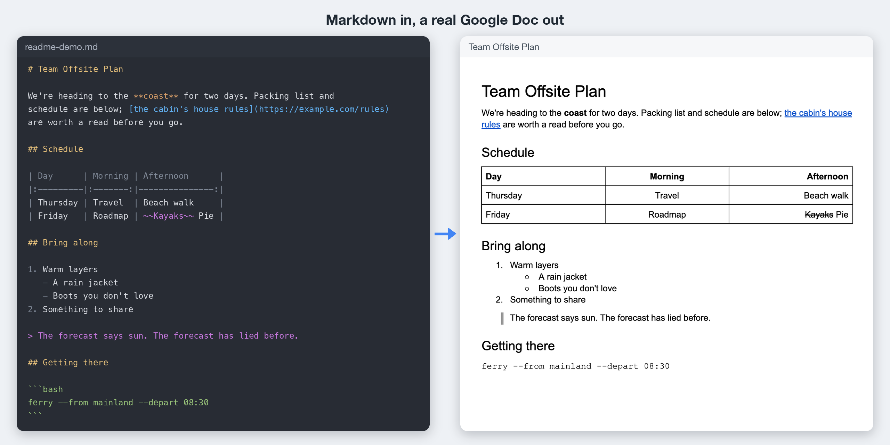

<div align="center">
  

  <b>mcp-gee-sweet</b>
  <p align="center"><i>A Google Workspace MCP server built for depth.</i></p>


</div>

<!-- mcp-name: io.github.khuisman/mcp-gee-sweet -->

mcp-gee-sweet gives AI clients deep, direct access to Google Sheets, Docs, Drive, Calendar, and Gmail. It reads raw formulas like `=VLOOKUP()`, builds Docs structurally (colspan/rowspan tables, themes, named styles, an HTML/Markdown→AST→Docs pipeline), and covers Drive files, sharing, and sync alongside Calendar events and Gmail messages, threads, and drafts.

A few highlights:
- **Caching** — repeated reads return in ~2ms from a local cache instead of a round-trip API call every time.
- **Formula access** — reads raw `=VLOOKUP()`, `=SUM()`, and `=IF()` expressions, not just the values they produce.
- **Local sync** — two-way sync between a local folder and Google Drive.



**Install (stable):**
```bash
uvx mcp-gee-sweet
```

**Install (bleeding edge — every code change on `develop`):**
```bash
uvx --prerelease=allow mcp-gee-sweet
```

**[Full documentation →](https://khuisman.github.io/mcp-gee-sweet/)**

---

## What's covered

| Service | Tools | Highlights |
|---|---|---|
| **Google Sheets** | 36 | Formula access, batch read/write, 8 chart types, structural ops |
| **Google Drive** | 38 | File ops, sharing/permissions, local sync, revision history |
| **Google Docs** | 34 | Full HTML→Doc pipeline, tables, range styling, themes, Markdown export |
| **Google Calendar** | 17 | Event CRUD, free-slot finder across multiple calendars |
| **Gmail** | 15 | Search and read messages and threads, send and reply, drafts you can review, edit, or discard before sending, labels (OAuth only). By default nothing is sent until the user confirms it; a client that can't ask leaves the email as a draft. See [Gmail sending](https://khuisman.github.io/mcp-gee-sweet/latest/configuration/#gmail-sending) |

---

## Quick start

### Option A: `uvx` in Claude Desktop — the fastest way in

This path goes from nothing to a first tool call in Claude Desktop on macOS. It runs the published package with `uvx`, so there's nothing to clone.

**1. Install `uv`.** It provides the `uvx` command. In a terminal:

```bash
curl -LsSf https://astral.sh/uv/install.sh | sh
```

(or `brew install uv`; other methods are in [uv's installation guide](https://docs.astral.sh/uv/getting-started/installation/)). Open a new terminal afterward so `uvx` is on your `PATH`, then check it with `uvx --version`.

**2. Create a Google OAuth client.** Follow [Method B in Authentication](https://khuisman.github.io/mcp-gee-sweet/latest/auth/#method-b-oauth-20-personal-use-local-dev), steps 1–4: they create a Google Cloud project, turn on the APIs, set up the consent screen, and download your OAuth client file. Then move the file to a folder of its own:

```bash
mkdir -p ~/mcp-gee-sweet
mv ~/Downloads/client_secret_*.json ~/mcp-gee-sweet/credentials.json
```

**3. Sign in to Google once.** This opens your browser to Google's consent page and saves a token next to the client file:

```bash
CREDENTIALS_PATH=$HOME/mcp-gee-sweet/credentials.json \
TOKEN_PATH=$HOME/mcp-gee-sweet/token.json \
uvx mcp-gee-sweet auth
```

For a `develop` build, use `uvx --prerelease=allow mcp-gee-sweet auth` instead. If Google says it hasn't verified the app, see [step 6 of Method B](https://khuisman.github.io/mcp-gee-sweet/latest/auth/#method-b-oauth-20-personal-use-local-dev).

**4. Find `uvx`'s full path.** Claude Desktop doesn't use your shell's `PATH`, so its config needs the full path:

```bash
command -v uvx    # e.g. /Users/you/.local/bin/uvx
```

**5. Add the server to Claude Desktop.** In Claude Desktop, open **Settings → Developer → Edit Config**. That shows you the config file, `~/Library/Application Support/Claude/claude_desktop_config.json`; open it in a text editor. Add this, using the path from step 4 and your own home folder in place of `/Users/you`:

```json
{
  "mcpServers": {
    "mcp-gee-sweet": {
      "command": "/Users/you/.local/bin/uvx",
      "args": ["mcp-gee-sweet"],
      "env": {
        "CREDENTIALS_PATH": "/Users/you/mcp-gee-sweet/credentials.json",
        "TOKEN_PATH": "/Users/you/mcp-gee-sweet/token.json"
      }
    }
  }
}
```

If the file already has an `mcpServers` block, add the `"mcp-gee-sweet"` entry inside it instead of adding a second block. Write full paths: the server doesn't expand `~`. For a `develop` build, use `"args": ["--prerelease=allow", "mcp-gee-sweet"]`.

**6. Restart Claude Desktop and try it.** Quit Claude Desktop completely (⌘Q, not just closing the window), reopen it, and ask something like "List my most recently modified Google Drive files."

Without step 3's token, the server still starts, and its first tool call returns a Google consent link instead: open it, approve, and ask again.

> **Running `uvx mcp-gee-sweet` by itself in a terminal** starts a stdio server. It logs a version line (and, with no token, a warning) and then waits silently for an MCP client to talk to it over stdin. Nothing else will happen, so press Ctrl+C: the server is meant to be started by your MCP client, as in step 5. With no credentials at all, it exits instead, with `All authentication methods failed. Please configure credentials.`

On Windows, the config file is `%APPDATA%\Claude\claude_desktop_config.json` and `where uvx` gives `uvx`'s path, but Windows isn't tested yet.

### Option B: `uv` with a cloned repo — local development

To work on the server's code or run your own changes, clone the repo. This needs `uv` too (step 1 above). No Docker required.

```bash
git clone https://github.com/khuisman/mcp-gee-sweet.git
cd mcp-gee-sweet
uv sync
```

Then point your MCP client at it using **stdio transport** (see [MCP client config](#mcp-client-config) below). The client spawns the server as a subprocess on demand — each session gets its own isolated process, so restarting the server for a code change or config update doesn't affect other open sessions.

### Option C: Docker — persistent shared server (SSE)

Use Docker when you want a single long-running server that multiple clients connect to over SSE — for example, Claude Desktop talking to the same instance as Claude Code.

```bash
git clone https://github.com/khuisman/mcp-gee-sweet.git
cd mcp-gee-sweet
echo "MCP_SERVER_TOKEN=$(python3 -c 'import secrets; print(secrets.token_urlsafe(32))')" >> .env
make build   # build the container image
make start   # start the server (SSE on port 47000)
make logs    # tail logs
```

Point your MCP client at `http://localhost:47000/sse`, sending the token from `.env` as an `Authorization: Bearer <token>` header (see the SSE config below). The server rejects any request without it. Without Docker, `--transport sse` and `--transport streamable-http` listen on `127.0.0.1` only, and need `MCP_SERVER_TOKEN` to serve on any other address; see [HTTP transport authentication](https://khuisman.github.io/mcp-gee-sweet/latest/configuration/#http-transport-authentication).

> **Note:** when using SSE, all clients share one server process. After a code change or restart (`make restart`), you must also restart each MCP client to reconnect.

---

## Configuration

The server tries auth methods in a waterfall by default, OAuth first — it authenticates as you and has full personal Drive access, which is what local use (Options A and B above) needs. For OAuth, download an OAuth Client ID JSON from Google Cloud ([how](https://khuisman.github.io/mcp-gee-sweet/latest/auth/#method-b-oauth-20-personal-use-local-dev)) and point the server at it. Then sign in once, with the command that matches how you run the server:

```bash
export CREDENTIALS_PATH="/path/to/credentials.json"
export TOKEN_PATH="/path/to/token.json"

uvx mcp-gee-sweet auth                      # PyPI install, stable
uvx --prerelease=allow mcp-gee-sweet auth   # PyPI install, develop builds
uv run mcp-gee-sweet auth                   # cloned repo, run from its folder
```

`uvx` doesn't put an `mcp-gee-sweet` command on your `PATH`, so a bare `mcp-gee-sweet auth` works only if you installed the package some other way (for example `uv tool install mcp-gee-sweet`).

Pass the same `CREDENTIALS_PATH` and `TOKEN_PATH` in your MCP client's `env`. A stdio server with no token doesn't open a browser itself. Instead its first tool call offers you the Google consent link (or you run the `auth` command above), and you retry the call. A token revoked mid-session is handled the same way, with no restart.

Service accounts (recommended for headless server deployments, see Option C above), base64 credential injection, and Application Default Credentials are also supported. Gmail tools need OAuth. See [Authentication](https://khuisman.github.io/mcp-gee-sweet/latest/auth/) for all options.

---

## MCP client config

**Claude Desktop — one-click bundle:** starting with the first release after 0.9.5 (until then, use Quick start's Option A), download `mcp-gee-sweet-<version>.mcpb` from the latest [GitHub Release](https://github.com/khuisman/mcp-gee-sweet/releases/latest), then double-click it, or install it from Claude Desktop's **Settings → Extensions**. It needs `uv` installed first (step 1 of Quick start's Option A). It asks for your OAuth client file and needs no config editing ([details](https://github.com/khuisman/mcp-gee-sweet/blob/main/docs/client-setup.md#install-as-a-bundle)).

**Claude Desktop — stdio (PyPI install):** see step 5 of Quick start's Option A.

**Claude Desktop — stdio (cloned repo):**
```json
{
  "mcpServers": {
    "mcp-gee-sweet": {
      "command": "uv",
      "args": ["run", "--directory", "/path/to/mcp-gee-sweet", "mcp-gee-sweet"],
      "env": {
        "CREDENTIALS_PATH": "/path/to/credentials.json",
        "TOKEN_PATH": "/path/to/token.json"
      }
    }
  }
}
```

**Claude Code — stdio (cloned repo):**
```bash
claude mcp add mcp-gee-sweet \
  -e ENABLED_TOOLS=all \
  -e CREDENTIALS_PATH=/path/to/credentials.json \
  -e TOKEN_PATH=/path/to/token.json \
  -- uv run --directory /path/to/mcp-gee-sweet mcp-gee-sweet
```

`ENABLED_TOOLS=all` keeps every tool when an upcoming release loads a smaller default set. For a PyPI install, replace everything after `--` with `uvx --prerelease=allow mcp-gee-sweet`: stable 0.9.5 reads `all` as a tool name and registers no tools, so with `uvx mcp-gee-sweet` leave the `ENABLED_TOOLS` line out until the next release. Run the `auth` command from Configuration above with the same `ENABLED_TOOLS`, since it decides the scopes.

**Claude Desktop — SSE (Docker):**
```json
{
  "mcpServers": {
    "mcp-gee-sweet": {
      "transport": "sse",
      "url": "http://localhost:47000/sse",
      "headers": {
        "Authorization": "Bearer <token>"
      }
    }
  }
}
```

See [Client Setup](https://khuisman.github.io/mcp-gee-sweet/latest/client-setup/) for more options including tool filtering.

### Using a client with a tool limit

Some MCP clients cap how many tools they accept, and with every tool registered this server is over each cap:

| Client | Limit |
|---|---|
| VS Code + GitHub Copilot (agent mode) | 128 tools per request, built-in tools included. Over it, every request fails with "Cannot have more than 128 tools per request" |
| Windsurf | 100 tools in total, across all servers |
| Cursor | Depends on the model ("Too many MCP tools are enabled for this mode") |
| Google Antigravity | 100 tools per server (user report) |

On these clients, set `ENABLED_TOOLS` in the server's `env` to one of the [suggested subsets](https://khuisman.github.io/mcp-gee-sweet/latest/configuration/#suggested-subsets), each under 100 tools, e.g. all Docs tools, or Docs + Drive combined. [Clients with a tool limit](https://khuisman.github.io/mcp-gee-sweet/latest/client-setup/#clients-with-a-tool-limit) has a ready-to-paste config for VS Code, Cursor, and Windsurf.

> **Upcoming change:** an upcoming release loads a smaller default tool set when `ENABLED_TOOLS` is unset. To keep every tool, set `ENABLED_TOOLS=all`, which registers every tool today as well, on a `develop` build. Stable 0.9.5 doesn't recognize `all` and registers no tools with it: leave `ENABLED_TOOLS` unset there, which already registers every tool.

---

## Docs

- [Tools](https://khuisman.github.io/mcp-gee-sweet/latest/tools/) — full tool reference, grouped by domain
- [Authentication](https://khuisman.github.io/mcp-gee-sweet/latest/auth/) — all four auth methods
- [Configuration](https://khuisman.github.io/mcp-gee-sweet/latest/configuration/) — env vars, caching, tool filtering
- [Client Setup](https://khuisman.github.io/mcp-gee-sweet/latest/client-setup/) — MCP client config examples
- [Design Principles](https://khuisman.github.io/mcp-gee-sweet/latest/design/) — tool inclusion policy, composite tool decisions
- [Roadmap](https://khuisman.github.io/mcp-gee-sweet/latest/roadmap/) — planned features and known gaps

---

## Contributing

See [CONTRIBUTING.md](https://github.com/khuisman/mcp-gee-sweet/blob/develop/CONTRIBUTING.md) for setup, QA workflows, and PR guidelines. A signed-off [`docs/qa/runs/vX.Y.Z.md`](https://github.com/khuisman/mcp-gee-sweet/tree/develop/docs/qa/runs) record is required before any stable PyPI release — see [`docs/qa/README.md`](https://github.com/khuisman/mcp-gee-sweet/blob/develop/docs/qa/README.md) for the QA workflow.

## License

MIT — see [LICENSE](https://github.com/khuisman/mcp-gee-sweet/blob/main/LICENSE).

## Credits

- [xing5/mcp-google-sheets](https://github.com/xing5/mcp-google-sheets) — upstream this project was forked from
- [FastMCP](https://github.com/cognitiveapis/fastmcp)
- [freema/mcp-gsheets](https://github.com/freema/mcp-gsheets) and [piotr-agier/google-drive-mcp](https://github.com/piotr-agier/google-drive-mcp) — roadmap inspiration
